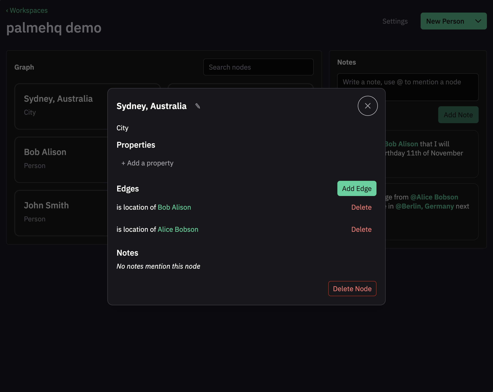
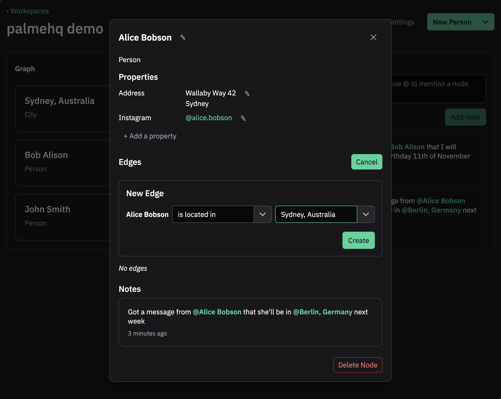
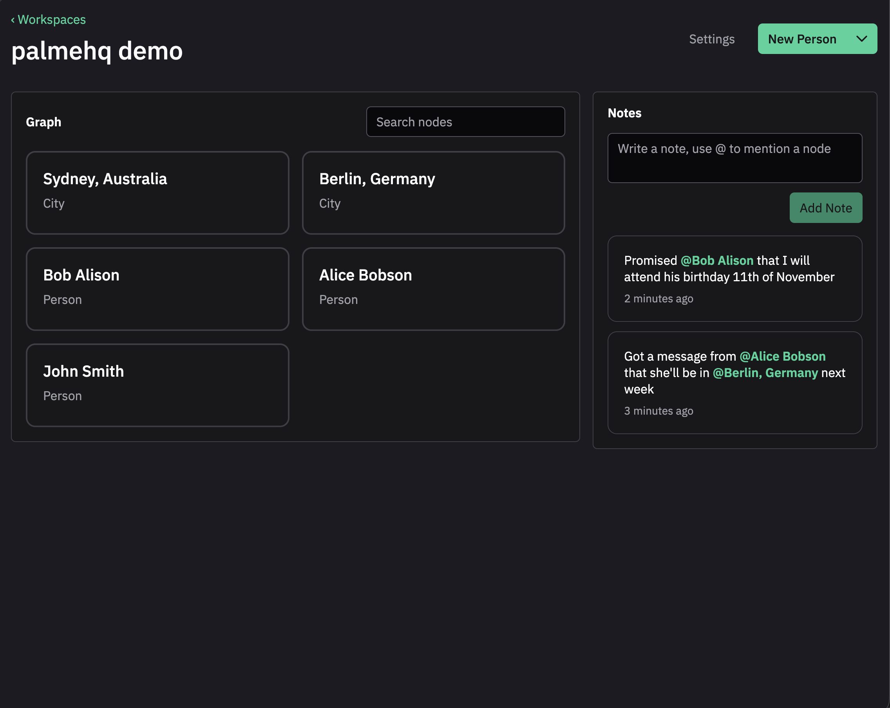

# Web frontend of Graph

A small tool to build knowledge graphs with notes.

- Add nodes, connect them with edges, navigate the graph
- Add properties on nodes (instagram account, textarea, text, etc etc)
- Add notes, mentioning nodes – which will appear also in reverse







## Tech

- typescript
- vue
- openvue
- tanstack query
- pnpm
- Hosted using [statichost.eu](https://statichost.eu)

## Development

To run with a local [backend server](https://github.com/palmenhq/graph-server) running:

```shell
pnpm install
pnpm dev
```
